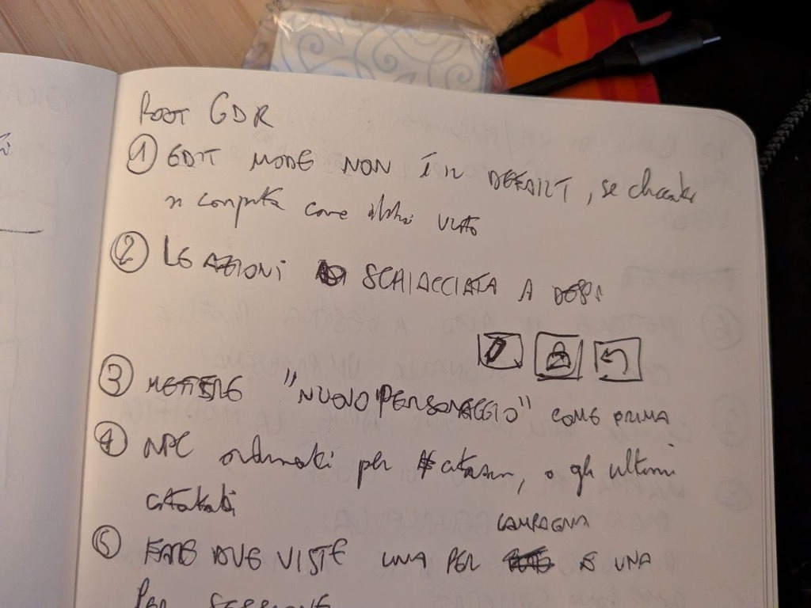
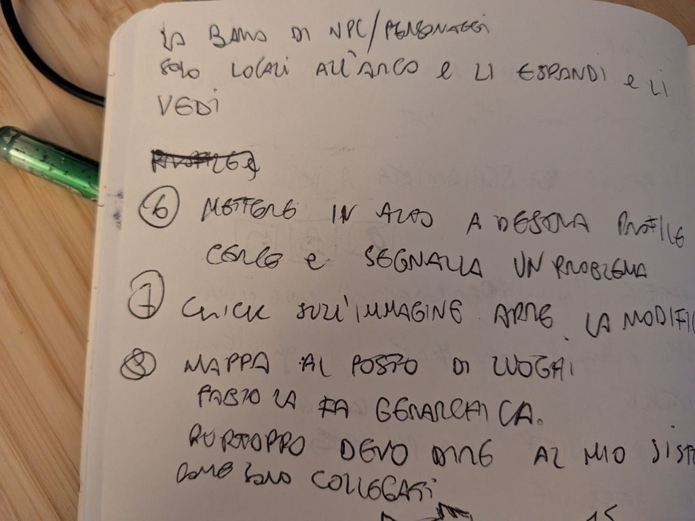
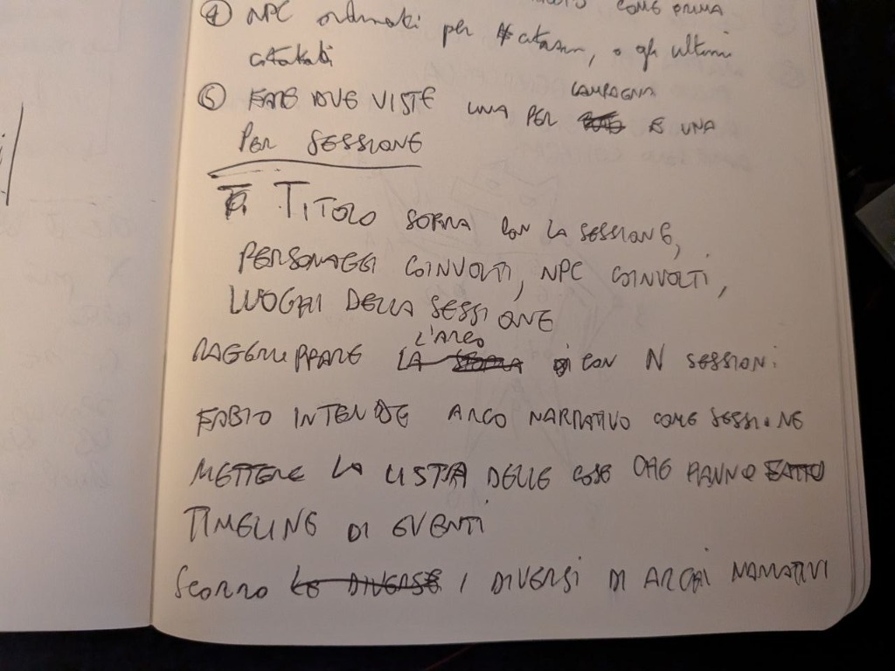

# Friend feedback and session context

## Purpose and authority

Account for the interface feedback in the three notebook photos supplied again
on 2026-10-21. The earlier bookkeeping brainstorming used the campaign notes
but did not systematically incorporate these comments. This request closes
that intake gap, identifies existing coverage and bounds missing work.

Friend suggestions are evidence, not automatically approved product decisions.
Unclear handwriting or an unrecorded demonstration must not become an invented
interaction contract. No application change, ticket registration, board
transition, assignment, release or restart is authorized by this document.

## Evidence

The following are English readings of the notes, not certified verbatim
transcriptions. Photos 1 and 3 repeat/expand numbered points 4 and 5; do not
count them as separate requests. The photo order below is reconstructed from
that numbering, not from upload order.

Original uploaded bytes are retained unchanged. Readable copies are rotated
90 degrees counterclockwise with no cropping or handwriting alteration.

### Photo 1 - Reading, document actions, creation and context

[Original photo](assets/REQ-0024/01-reading-actions-create-original.jpg).
The last note continues beyond the photographed bottom edge.

### Photo 2 - Local people, global controls, image behavior and map

[Original photo](assets/REQ-0024/02-context-shell-images-map-original.jpg).
The top line continues the local-people/context idea.

### Photo 3 - NPC ordering, session composition and narrative navigation

[Original photo](assets/REQ-0024/03-session-and-story-context-original.jpg).
The friend's use of "narrative arc" is a terminology observation, not authority
to equate a story and a session after the owner's subsequent clarification.

## Observation ledger

Each stable FB key below has one source, a bounded reading and a disposition.
"Existing coverage" means specification/source overlap, not a verified fix.
No live ticket status is maintained in this ledger.

### FB-01 - Reading versus edit behavior

**Source:** photo 1, note 1: edit mode is not the default; clicking behaves as
demonstrated. The demonstration itself is not preserved.
**Assessment:** default reading is already the product direction. The photo
does not establish that double-click, global edit mode or immediate editing
should replace current block interaction.
**Route:** T02 checks discoverability and records missing interaction detail.
Related existing work: REQ-0019/T04 and T09; retain their scope and current
editor keys rather than claim they resolve this whole observation.

### FB-02 - Actions pushed to the right

**Source:** photo 1, note 2 and the sketch of three compact action buttons.
**Assessment:** command grouping/alignment needs review, not another wholesale
icon redesign. Current Docbar uses separated status/command regions.
**Route:** T02 compares action placement. Respect
[REQ-0005](REQ-0005-document-toolbar-and-status-design.md)'s accepted icon-only
commands; any departure requires an explicit new decision.

### FB-03 - Restore the previous "Nuovo personaggio" affordance

**Source:** photo 1, note 3: put "Nuovo personaggio" as before.
**Assessment:** the requested earlier placement is not documented by the photo.
Current CharacterList places a create card after the existing characters.
**Route:** reconcile with REQ-0019/T26 and T27; T02 records whether the complaint
also concerns desktop/labeling, since those existing tickets emphasize phone
reachability. Do not open a duplicate creation implementation ticket.

### FB-04 - NPC ordering by citations or recent citation

**Source:** photos 1/3, note 4.
**Assessment:** genuine missing discovery requirement. Current NPC lists sort
by name. Citation frequency and "last mentioned" are different orderings.
**Route:** T05 selects their semantics and presentation; T06 implements the
selected options. Do not silently equate recent editing with recent citation.

### FB-05 - Campaign and session views

**Source:** photos 1/3, note 5.
**Assessment:** the notes propose different contextual views, not necessarily
another campaign data model. World, story and played session are already
distinct in the owner's clarified vocabulary.
**Route:** T07 designs the context boundaries; T08-T09 implement the selected
data/UI. A context changes what is shown, not the underlying entity's identity.

### FB-06 - Session title, characters, NPCs and places

**Source:** photo 3: session title above, then involved characters, NPCs and
locations of the session.
**Assessment:** the current session page already has a title. It does not have
the proposed explicit participation/location groups; generic backlinks are not
equivalent. REQ-0021/T14 covered story/conflict context, not this full requirement.
**Route:** T07-T09 add the selected session context without turning prose into
a mandatory event form. Decide explicit involvement versus mention-derived
suggestions before implementing relationships.

### FB-07 - Group sessions by story and move between stories

**Source:** photo 3: group an arc with N sessions; browse different arcs.
**Assessment:** story/session association and an included-session list already
exist; contextual switching/grouping is only partly covered. A friend's possible
equation of arc/session is not adopted.
**Route:** extend REQ-0021/T09/T14 through T07-T09, preserving their M:N
story/session contract. Do not replace a story with a session or create duplicate
session records to fit the navigation.

### FB-08 - Expandable people list local to the current story

**Source:** photo 2 top line, continuing the context idea: local NPCs/characters
in the arc, expandable to inspect them.
**Assessment:** REQ-0021/T09 includes NPC quick references in conflicts; it does
not fully cover a story/session-scoped list that also includes characters.
**Route:** T07-T09 explore the local list and expansion, reusing the selected NPC
card presentation. Do not make each appearance a copied person or new track state.

### FB-09 - Profile, search and report at the upper right

**Source:** photo 2, note 6.
**Assessment:** placement/discoverability suggestion. Current account menu is
in the rail; phone Topbar contains search and report. Moving all three together
is not specified by a search-hint or report-loading repair.
**Route:** T03 prototypes/selects global-action grouping; T04 implements only
the selected arrangement. Preserve report recovery, authentication and access.

### FB-10 - Clicking an image opens modification

**Source:** photo 2, note 7.
**Confirmed intent:** the owner clarified that clicking an image to open
modification is wanted, not an unwanted behavior report.
Current editable ImageEditor makes the image surface a file-input label; it
opens upload/replacement. The prototype should expose the image-modification
workflow clearly, respecting locked/read-only state and keyboard activation.
**Route:** T02 prototypes the affordance and checks existing REQ-0019/T24-T25
appearance-control work. Do not substitute a viewer for modification or assume
a new full image editor is required. Where image editing and card flipping
coexist, one action must not accidentally trigger the other.

### FB-11 - Geographic map and connections between places

**Source:** photo 2, note 8: map instead of places, geographic layout and telling
the system how places connect.
**Assessment:** place relationships/control in REQ-0021 are not an interactive
geographic map. A map is not automatically the geometric drawing/canvas feature.
**Route:** retained as an unselected map idea. No map implementation enters this
cycle without owner selection. Canvas remains paused; do not silently delete
this separate suggestion or revive canvas under the name of a map.

### FB-12 - What happened, event timeline

**Source:** photo 3: list what they did and a timeline of events.
**Assessment:** the owner subsequently selected notebook-style session prose,
with future LLM event extraction, scene grouping and timeline views.
**Route:** preserve the explicit deferral in REQ-0021/REQ-0022; conflict development
history is included now but is not that future event engine. Do not replace the
session account with mandatory bullets or claim the timeline is implemented.

## Existing work and read-only board reconciliation

On 2026-10-21, the existing loopback tunnel was used to verify the real
`Root GDR` project (ID 2) and list its 87 tasks, including descriptions.
No tunnel was created and no board mutation or attachment upload occurred.
Request keys 0020-0024 were not allocated by those task titles/descriptions;
repository metadata was also checked before allocating REQ-0024.

Relevant exact board identities, not a live status mirror:

| Existing key | Task ID | Relationship to these photos |
| --- | --- | --- |
| REQ-0019/T04 | 59 | Identity-edit semantics, not the whole FB-01 interaction |
| REQ-0019/T09 | 64 | Touch editing exit, not default-mode discoverability |
| REQ-0019/T24 | 82 | Appearance disclosure decision, partial FB-10 overlap |
| REQ-0019/T25 | 83 | Selected appearance arrangement, not presumed image behavior |
| REQ-0019/T26 | 84 | Phone collection-create decision, FB-03 overlap |
| REQ-0019/T27 | 85 | Selected creation arrangement, FB-03 overlap |
| REQ-0019/T28 | 86 | Phone search hints, not FB-09 action relocation |
| REQ-0014/T02 | 3 | Existing report panel, not a shell-placement decision |

REQ-0005's toolbar decision is a repository reference; this read found no
dedicated REQ-0005 task title. Do not infer implementation or completion from
that absence. Re-read current board comments and integration evidence before
changing any existing scope. Source/handwriting review here does not reproduce
these reports against a running application or verify another agent's fix.

## User stories and boundaries

- As GM, I find frequently/recently relevant NPCs without scanning alphabetically.
- As GM, I switch between world, prepared story and played-session context and
  find the relevant people/places without losing my writing position.
- As GM, I recognize how to create, edit and inspect images without guessing
  what an icon or image click will do.
- As a user, I can reach profile, search and reporting consistently on phone
  and desktop without losing report drafts or keyboard accessibility.

Keep the accepted atlas language, icon-only document commands, in-place prose,
drafts, locks, ownership and optimistic updates. Explicit participants and text
mentions must not be silently equated. A newly linked person must pass normal
world/draft checks and use recovery snapshots; private mention counts must not
reveal invisible content. No new campaign taxonomy or timeline architecture.

## Ticket plan

This is a proposed decomposition of missing/uncertain work, not newly registered
board tasks. Reuse the existing tickets above where scope matches. All UI
implementation follows [REQ-0020's verification contract](REQ-0020-world-history-and-reversible-changes.md#verification-contract),
with real persisted-state checks, desktop/phone prototype comparisons, scoped
commits and thematic manuals. New discovery changes require an accepted
prototype, not just this photo transcript. Significant changes use
`REQ-0024-Tnn.<type>.md`.

### REQ-0024/T01 - Parent: account for every friend-feedback observation

**Outcome:** all FB keys have a documented existing owner, accepted bounded
implementation, explicit deferral or clarified decision.
**Acceptance:** no comment disappears, no existing repair is duplicated, and
unselected map/timeline ideas are not treated as implemented work.
**Verify:** source-to-ticket matrix and accepted child outcomes; live progress
remains in Vikunja, not the observation ledger.

### REQ-0024/T02 - Resolve document/create/image interaction ambiguities

**Story:** I understand the actions available without accidental editing.
**Depends:** existing REQ-0019/T04/T09/T24-T27 outcomes, read as applicable scope
evidence rather than a blanket requirement to finish every unrelated child.
**Boundary:** FB-01/02/03/10, Docbar/ImageEditor/create affordance; decision only.
**Acceptance:** reproduce current behavior, compare desktop/phone and determine
the missing demonstrated behavior and prior create placement. Image-click
modification is confirmed; prototype its discoverability and separation from
other actions, preserving locked/read-only and keyboard behavior.
Preserve accepted icon-only commands unless the owner explicitly changes them.
Route selected repairs to existing scope or a separately approved bounded ticket.
**Verify:** captures and concise accepted interaction record; do not claim that
reading photos proves a bug or authorizes a viewer/global edit-mode rewrite.

### REQ-0024/T03 - Select global profile/search/report placement

**Story:** I consistently find account, search and reporting actions.
**Depends:** inspect REQ-0019/T28 and existing report/menu behavior.
**Boundary:** FB-09, shell/action hierarchy prototypes; no authentication redesign.
**Acceptance:** compare current placement with the suggested upper-right group
at desktop/phone, long titles and open dialogs; preserve navigation space and
44px targets; record chosen placement, keyboard order and responsive fallback.
**Verify:** same-data prototypes and accepted decision; separate the decision
from search-hint corrections or report-loading work already ticketed.

### REQ-0024/T04 - Implement selected global-action hierarchy

**Story:** the accepted action arrangement works through ordinary navigation.
**Depends:** T03 selection.
**Boundary/start:** `layout/{Page,Rail,Topbar,UserMenu}` and report/palette triggers.
**Acceptance:** no duplicate account IDs/triggers/listeners; profile, search and
report remain reachable at all widths and permissions; open report drafts,
menu focus return and browser navigation survive; no unauthorized actions.
**Verify:** frontend/E2E trigger and draft-recovery checks, keyboard/touch and
desktop/phone screenshots against the selected prototype.

### REQ-0024/T05 - Define citation-based NPC ordering

**Story:** I can find NPCs by campaign relevance rather than only their names.
**Depends:** no new domain writes; inspect references and story/session context.
**Boundary:** FB-04 semantic/design decision before exposing sort options.
**Acceptance:** decide frequency/recency options, world versus local scope,
raw mentions versus distinct referring documents, eligible source types and
stable ties; define what "recently mentioned" means. Existing reference rows
deduplicate source labels and are rebuilt on edits, so their insertion time is
not automatically a faithful citation-history timestamp.
**Verify:** concrete same-data examples, invisible/draft sources, repeated names
and unrelated source edits; record accepted semantics and rejected shortcuts.

### REQ-0024/T06 - Implement approved NPC sort options

**Story:** the selected order is stable, useful and permission-safe.
**Depends:** T05 selection; T08 only if local participation is the chosen source.
**Boundary/start:** `npcs/service.py`, typed list query, reference queries and
collection controls; not a global analytics system.
**Acceptance:** selected ordering works with pagination/empty data, stable ties
and canonical NPC identity; no hidden-document counts/titles leak; unrelated
edits do not falsely change recency under the chosen definition; preserve the
selected sort through relevant navigation without changing saved NPC content.
**Verify:** integration query/access tests, frontend sort selection and E2E
relevant/local fixtures with desktop/phone comparison.

### REQ-0024/T07 - Select world/story/session context and involvement semantics

**Story:** I find the people and places relevant to what I am preparing or playing.
**Depends:** accepted REQ-0021/T02/T09/T14 behavior and current story/session API.
**Boundary:** FB-05/06/07/08 contextual composition and data-ownership decision.
**Acceptance:** map "campaign" to existing world/story concepts explicitly;
distinguish characters, NPCs, locations, mentions and actual involvement;
select manual links versus derived suggestions, story grouping/switching and
local expandable views. Preserve notebook prose and the owner's story definition.
**Verify:** one story/two sessions, one session/multiple stories, mentioned-but-
absent person, shared temple and long/empty lists in the same-data prototype.

### REQ-0024/T08 - Context membership and relevance data

**Story:** the selected local view reflects real links, not guessed participation.
**Depends:** T07 selection and REQ-0020 recovery plus corresponding REQ-0021 models.
**Boundary/start:** story/session services, typed references and derived queries;
add explicit associations only if selected.
**Acceptance:** world-scoped canonical people/places, optional links and valid
M:N story/session relationships; hidden/deleted references filtered; explicit
membership never silently follows every text mention; new writes are versioned
and compensatable. Existing stories/sessions retain body and associations.
**Verify:** database/API selected semantics, cross-world IDs, drafts, ambiguous
names, unlink/restore and a single NPC shared across contexts.

### REQ-0024/T09 - Contextual session/story presentation

**Story:** I browse stories and sessions with a local, expandable people/place view.
**Depends:** T07-T08, selected REQ-0021 NPC presentation.
**Boundary/start:** story/session/world view models and pages, not a new editor.
**Acceptance:** clear current title/context, grouped sessions and navigable
stories; local characters/NPCs/places as selected; expand without losing prose
position or pending saves; all NPC appearances use canonical marks/state;
empty, shared and hidden contexts are understandable. No map/timeline built.
**Verify:** frontend and persisted E2E two-session journey, keyboard/focus,
long lists, saved context selection and desktop/phone comparison.

## Follow-up and unresolved choices

T02 and T03 are decisions, not permission to implement every alternative.
T05 precedes ordering implementation. T07 precedes participation schema and UI;
choosing a derived view may eliminate the need for new association tables.
Explicitly record that outcome rather than building both models.

Only unambiguous suggestions are translated here. The demonstrated edit
interaction, previous create placement and
precise narrative-browsing wording require confirmation before their UI changes.
Those uncertainties do not block preservation, mapping or unrelated work.
Image-click modification is confirmed and no longer an open intent question.

This request supplements rather than replaces
[REQ-0021](REQ-0021-gm-campaign-bookkeeping.md). Consult
[REQ-0019](REQ-0019-frontend-system-stability-and-workflow.md)'s existing
decisions and test evidence; no worker is assigned or interrupted here.
For current behavior, see
[collection creation](../features-implemented/collection-create-card.md),
[document commands](../features-implemented/docbar-regions.md),
[image editing](../features-implemented/live-image-editor.md) and
[story composition](../features-implemented/story-composition.md).
